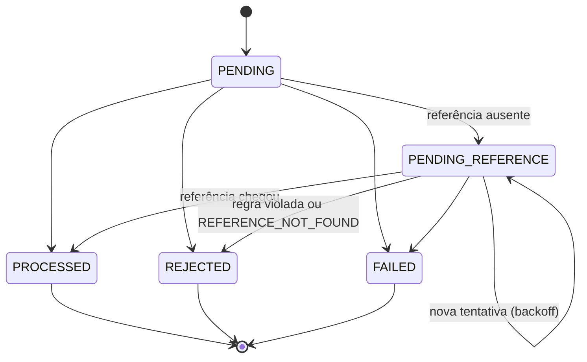

# Arquitetura

Documento vivo: cada seção entra junto com o código que ela descreve. Persistência, concorrência e mensageria ainda serão detalhadas.

## Visão geral

```
src/
  domain/           regras de negócio puras: sem NestJS, sem ORM, sem I/O
    shared/         Money, erros, ids, backoff, JSON canônico
    wallet/         Wallet (aggregate root) e WalletLedgerEntry
    wagering/       WagerTransaction, códigos de falha, hash de payload, settleWager
    events/         eventos de integração
    messaging/      InboxMessage e OutboxMessage
  infrastructure/   adaptadores: PostgreSQL (MikroORM) e SQS
  health/           liveness e readiness
```

O domínio não importa nada de fora dele. Toda regra de negócio pode ser testada sem banco e sem fila (`bun run test:unit`). A infraestrutura cuida do que o domínio não pode garantir sozinho: locks, constraints e atomicidade.

## Ambiente

| Peça | Escolha | Motivo |
|---|---|---|
| Emulador AWS | MiniStack | A imagem community do LocalStack passou a exigir token de conta. O MiniStack expõe a mesma API na porta 4566 e é citado no enunciado. |
| PostgreSQL | 18 | Versão estável atual. |
| Migrations | escritas à mão (snapshot do MikroORM desligado) | O schema depende de `CHECK`, índices parciais e triggers que queremos revisar como SQL, e não gerados a partir das entidades. |
| Filas | `wager-transactions.fifo`, `wager-transactions-dlq.fifo` e `wager-events.fifo` | Criadas pelo script `docker/ministack/ready.d`. A DLQ recebe a mensagem após 5 recebimentos sem sucesso. |

## Modelo de domínio

Toda classe do domínio segue o mesmo formato: construtor privado, factories estáticas (`create`/`open`/`from`) que validam regras, e `rehydrate`, que reconstrói o estado vindo do banco **sem** revalidar transições.

### Money

- Guardado como `bigint` de centavos, com escala fixa de 2 casas. Em nenhum lugar há `number` para dinheiro.
- **Entrada:** string decimal com 0 a 2 casas, normalizada para 2 (`"25"` vira `"25.00"`). São rejeitados: string vazia, `NaN`, `Infinity`, notação científica, sinal (`+`/`-`), zeros à esquerda, vírgula, espaços, **mais de 2 casas** e mais de 18 dígitos inteiros (o limite de `NUMERIC(20,2)`).
- **Nunca arredonda.** `"10.005"` é rejeitado. Arredondar dinheiro em silêncio cria ou destrói centavos; quem manda 3 casas tem um bug que precisa aparecer.
- É imutável (`Object.freeze`): toda operação devolve uma nova instância.
- Negativos só surgem de aritmética interna (`subtract`, `negate`), nunca de um contrato de entrada.
- Moedas diferentes: `add`, `subtract` e `isLessThan` lançam `CurrencyMismatchError`. Já `equals` apenas devolve `false`, porque perguntar se dois valores são iguais não é um erro.

### Wallet (aggregate root)

- `debit` e `credit` são o **único** caminho para mudar o saldo, e ambos devolvem o `WalletLedgerEntry` correspondente. Dentro do domínio, saldo e ledger não têm como divergir.
- O lançamento é montado e validado **antes** de qualquer campo mudar. Um movimento recusado deixa a wallet exatamente como estava.
- `version` vale 1 após a abertura e sobe 1 a cada lançamento. `LOSS` e transações rejeitadas não mexem nela.
- **Abertura:** um saldo inicial positivo vira uma transação interna `OPENING` e é creditado pelo mesmo `credit` de qualquer outra transação. O ledger explica o saldo desde o primeiro centavo, e a reconciliação parte de zero.

### WalletLedgerEntry

- Imutável na estrutura: campos `readonly`, `Object.freeze` e nenhum método de transição. Correção é sempre um lançamento novo.
- `create` valida `balanceBefore ± money = balanceAfter`, exige valor positivo e não aceita saldo final negativo.
- Cada lançamento registra a `walletVersion` que produziu. No banco isso vira `UNIQUE (wallet_id, wallet_version)`: dois lançamentos escritos sobre a mesma versão (um *lost update*) colidem na constraint, mesmo que o controle de concorrência da aplicação falhe.

### WagerTransaction



- `PROCESSED`, `REJECTED` e `FAILED` são terminais. Tentar sair deles lança `InvalidTransactionStateError`, que **não** é um `DomainError`: é bug nosso e não um resultado de negócio, então vira 500 e não 422.
- `OPENING` só nasce por `WagerTransaction.opening()`. `create()` recusa esse kind, e o `providerId` `internal` é reservado.
- `resultingBalance` guarda o saldo observado quando o resultado foi decidido. É o que um replay devolve (regra 7), mesmo que a wallet já tenha mudado depois.

### Regras de liquidação: `settleWager`

Uma função pura recebe a wallet (já travada por quem chama), a transação e a referência resolvida. Ela decide o resultado, aplica-o em memória e devolve o lançamento e os eventos a persistir. Ordem das verificações:

1. A wallet pertence ao `playerId`? Se não, `WALLET_PLAYER_MISMATCH`.
2. A moeda é a mesma da wallet? Se não, `CURRENCY_MISMATCH`.
3. Se há referência: ela ainda não chegou ou não terminou? Então `PENDING_REFERENCE`. Ela é inválida? Então rejeita com o código específico.
4. `LOSS`: `PROCESSED`, sem lançamento e sem mexer na versão.
5. É débito e não há saldo? `INSUFFICIENT_FUNDS` para aposta, `REVERSAL_INSUFFICIENT_FUNDS` para reversão.
6. Caso contrário, aplica `debit`/`credit` e marca `PROCESSED`.

| Operação | Efeito | Referência |
|---|---|---|
| `BET` | débito | não pode ter |
| `WIN` | crédito | opcional, deve ser `BET` |
| `LOSS` | nenhum | opcional, deve ser `BET` |
| `REFUND` | crédito | obrigatória, deve ser `BET` |
| `ROLLBACK` | inverso da referência | obrigatória: `BET`, `WIN` ou `REFUND` |

### Interpretações adotadas

1. **Uma transação é revertida no máximo uma vez, qualquer que seja o tipo da reversão.** O enunciado proíbe reverter duas vezes "pelo mesmo tipo", mas um `REFUND` seguido de um `ROLLBACK` da mesma `BET` creditaria o valor duas vezes, o que fere o invariante global de não duplicar créditos. Para desfazer um `REFUND`, o provedor faz `ROLLBACK` **do `REFUND`**.
2. `WIN` e `LOSS` podem apontar para a `BET` da rodada. Se apontarem para uma referência que ainda não existe, esperam como qualquer outra transação.
3. `LOSS` aceita valor zero. As demais operações exigem valor maior que zero.
4. Uma referência ainda pendente (`PENDING`/`PENDING_REFERENCE`) faz a transação esperar. Uma referência `REJECTED`/`FAILED` gera `REFERENCE_NOT_PROCESSED`, porque não há nada a reverter.
5. **Espera por referência:** são 10 tentativas, com backoff exponencial começando em 1s (1s, 2s, 4s… com teto de 5 min). A última consulta acontece cerca de 8,5 minutos após a primeira. Fora de ordem, na prática, é questão de segundos; se a referência não apareceu em minutos, ela provavelmente nunca foi enviada, e o provedor precisa saber disso logo. Depois disso, `REJECTED` com `REFERENCE_NOT_FOUND`.
6. `WagerTransactionPendingReference` é publicado só na primeira falta da referência. As tentativas seguintes são controle interno.

### Códigos de falha

Todos são terminais para aquela `Idempotency-Key`. Reenviar o mesmo payload devolve o mesmo resultado (replay), e um payload corrigido com a mesma chave é conflito. Por isso, "corrigir" significa enviar uma **nova** transação.

| Código | Quando | O que o provedor faz |
|---|---|---|
| `INSUFFICIENT_FUNDS` | `BET` maior que o saldo | Nada: é o resultado da aposta |
| `REVERSAL_INSUFFICIENT_FUNDS` | `ROLLBACK` de `WIN`/`REFUND` sem saldo para cobrir | Escalar para operação ou antifraude |
| `CURRENCY_MISMATCH` | moeda diferente da wallet | Corrigir e enviar como nova transação |
| `WALLET_PLAYER_MISMATCH` | a wallet não é do `playerId` | Corrigir e enviar como nova transação |
| `REFERENCE_NOT_FOUND` | a referência não chegou dentro das tentativas | Conferir se a original foi enviada; mandar nova reversão depois |
| `REFERENCE_MISMATCH` | referência de outro player, wallet, rodada ou moeda | Corrigir a referência |
| `REFERENCE_KIND_NOT_ALLOWED` | ex.: `REFUND` de um `WIN` | Usar a operação certa |
| `REFERENCE_NOT_PROCESSED` | a referência foi rejeitada ou falhou | Nada: não há o que reverter |
| `REFERENCE_AMOUNT_MISMATCH` | valor diferente da referência | Corrigir; reversão parcial não é suportada |
| `REFERENCE_ALREADY_REVERSED` | a referência já foi revertida | Nada |
| `PROCESSING_FAILED` | falha permanente de infraestrutura (`FAILED`) | Acionar o suporte |

### Hash do payload (idempotência)

- **Campos:** `providerId`, `externalTransactionId`, `playerId`, `walletId`, `roundId`, `gameId`, `kind`, `money` e `referenceExternalTransactionId`. Eles são escolhidos explicitamente; um campo novo em outro lugar nunca muda o hash de transações antigas.
- **Ficam fora:** o header `Idempotency-Key` e os metadados de transporte (`messageId`, `occurredAt`). A chave diz *qual* operação é; o hash diz se o *conteúdo* é o mesmo.
- **JSON canônico:** chaves ordenadas por code unit UTF-16 (a mesma ordem do RFC 8785), valores `undefined` omitidos, sem espaços, e `Money` já normalizado (`"25.5"` e `"25.50"` dão o mesmo hash).
- **Algoritmo:** SHA-256, codificado em hexadecimal.

### Eventos de integração

| Evento | Quando |
|---|---|
| `WagerTransactionProcessed` | qualquer transação aplicada, inclusive `LOSS` |
| `WagerTransactionRejected` | rejeição por regra de negócio |
| `WalletBalanceChanged` | somente quando o saldo mudou |
| `WagerTransactionPendingReference` | primeira vez que a referência faltou |

- `eventType` e `version` ficam na própria subclasse. Nenhum call site passa string solta.
- `data` é JSON puro (`MoneyProps`, datas ISO-8601). Nunca carrega instâncias do domínio.
- O `aggregateId` é sempre o `walletId`. A wallet é a fronteira de consistência, e o publisher usa o `aggregateId` como grupo FIFO, então um consumidor recebe os eventos de uma wallet na ordem do commit.
- O `eventId` é reaproveitado como id da outbox e como id de deduplicação no SQS. É também a chave de deduplicação para os consumidores.

### Inbox e Outbox

- `InboxMessage` registra uma mensagem já tratada por um consumidor e é gravada **na mesma transação SQL** que os efeitos dela.
- `OutboxMessage` tenta publicar **para sempre**, com backoff de 1s até 60s. Perder um evento confirmado não é aceitável; uma mensagem travada aparece como *outbox lag* nas métricas, e não é descartada.

### Identificadores

UUIDv7 (`Bun.randomUUIDv7()`). Como começa pelo timestamp, as chaves novas entram no fim do índice B-tree, em vez de cair em páginas aleatórias como o UUIDv4.
