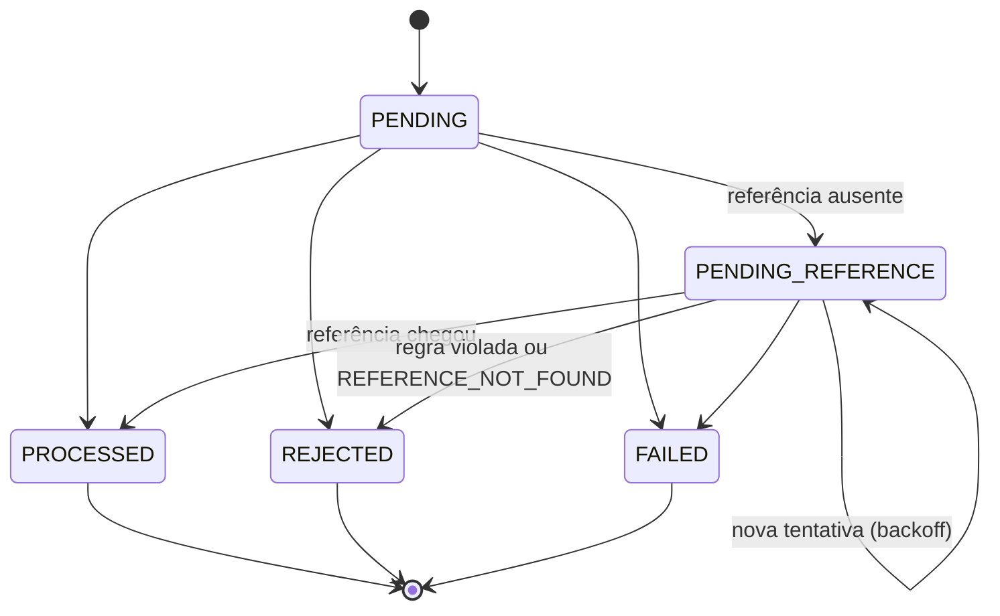

# Arquitetura

Documento vivo: cada seção entra junto com o código que ela descreve.

## Visão geral

```
src/
  domain/           regras de negócio puras: sem NestJS, sem ORM, sem I/O
    shared/         Money, erros, ids, backoff, JSON canônico
    wallet/         Wallet (aggregate root) e WalletLedgerEntry
    wagering/       WagerTransaction, códigos de falha, hash de payload, settleWager
    events/         eventos de integração
    messaging/      InboxMessage e OutboxMessage
  application/      casos de uso e portas (UnitOfWork, repositórios): sem NestJS, sem ORM
  infrastructure/   adaptadores: PostgreSQL (MikroORM) e SQS
  http/             controllers, contratos de resposta e o filtro de erros
  workers/          laços em segundo plano (consumidor SQS, relay da outbox, referências pendentes) e o desligamento gracioso
  health/           liveness e readiness
  app.module.ts     composição: o único lugar que liga as peças
```

As dependências apontam para dentro: `http` e `infrastructure` dependem de `application`, que depende de `domain`, que não depende de nada. Toda regra de negócio pode ser testada sem banco e sem fila (`bun run test:unit`). A infraestrutura cuida do que o domínio não pode garantir sozinho: locks, constraints e atomicidade.

## Ambiente

| Peça | Escolha | Motivo |
|---|---|---|
| Emulador AWS | MiniStack | A imagem community do LocalStack passou a exigir token de conta. O MiniStack expõe a mesma API na porta 4566 e é citado no enunciado. |
| PostgreSQL | 18 | Versão estável atual. |
| Migrations | escritas à mão (snapshot do MikroORM desligado) | O schema depende de `CHECK`, índices parciais e triggers que queremos revisar como SQL, e não gerados a partir das entidades. |
| Filas | `wager-transactions.fifo`, `wager-transactions-dlq.fifo` e `wager-events.fifo` | Criadas pelo script `docker/ministack/ready.d`. A DLQ recebe a mensagem após 5 recebimentos sem sucesso. |

## Modelo de domínio

Toda classe do domínio segue o mesmo formato: construtor privado, factories estáticas (`create`/`open`/`from`) que validam regras, e `rehydrate`, que reconstrói o estado vindo do banco **sem** revalidar transições.

### Money

- Guardado como `bigint` de centavos, com escala fixa de 2 casas. Em nenhum lugar há `number` para dinheiro.
- **Entrada:** string decimal com 0 a 2 casas, normalizada para 2 (`"25"` vira `"25.00"`). São rejeitados: string vazia, `NaN`, `Infinity`, notação científica, sinal (`+`/`-`), zeros à esquerda, vírgula, espaços, **mais de 2 casas** e mais de 18 dígitos inteiros (o limite de `NUMERIC(20,2)`).
- **Nunca arredonda.** `"10.005"` é rejeitado. Arredondar dinheiro em silêncio cria ou destrói centavos; quem manda 3 casas tem um bug que precisa aparecer.
- É imutável (`Object.freeze`): toda operação devolve uma nova instância.
- Negativos só surgem de aritmética interna (`subtract`, `negate`), nunca de um contrato de entrada.
- Moedas diferentes: `add`, `subtract` e `isLessThan` lançam `CurrencyMismatchError`. Já `equals` apenas devolve `false`, porque perguntar se dois valores são iguais não é um erro.

### Wallet (aggregate root)

- `debit` e `credit` são o **único** caminho para mudar o saldo, e ambos devolvem o `WalletLedgerEntry` correspondente. Dentro do domínio, saldo e ledger não têm como divergir.
- O lançamento é montado e validado **antes** de qualquer campo mudar. Um movimento recusado deixa a wallet exatamente como estava.
- `version` vale 1 após a abertura e sobe 1 a cada lançamento. `LOSS` e transações rejeitadas não mexem nela.
- **Abertura:** um saldo inicial positivo vira uma transação interna `OPENING` e é creditado pelo mesmo `credit` de qualquer outra transação. O ledger explica o saldo desde o primeiro centavo, e a reconciliação parte de zero.

### WalletLedgerEntry

- Imutável na estrutura: campos `readonly`, `Object.freeze` e nenhum método de transição. Correção é sempre um lançamento novo.
- `create` valida `balanceBefore ± money = balanceAfter`, exige valor positivo e não aceita saldo final negativo.
- Cada lançamento registra a `walletVersion` que produziu. No banco isso vira `UNIQUE (wallet_id, wallet_version)`: dois lançamentos escritos sobre a mesma versão (um *lost update*) colidem na constraint, mesmo que o controle de concorrência da aplicação falhe.

### WagerTransaction



- `PROCESSED`, `REJECTED` e `FAILED` são terminais. Tentar sair deles lança `InvalidTransactionStateError`, que **não** é um `DomainError`: é bug nosso e não um resultado de negócio, então vira 500 e não 422.
- `OPENING` só nasce por `WagerTransaction.opening()`. `create()` recusa esse kind, e o `providerId` `internal` é reservado.
- `resultingBalance` guarda o saldo observado quando o resultado foi decidido. É o que um replay devolve (regra 7), mesmo que a wallet já tenha mudado depois.

### Regras de liquidação: `settleWager`

Uma função pura recebe a wallet (já travada por quem chama), a transação e a referência resolvida. Ela decide o resultado, aplica-o em memória e devolve o lançamento e os eventos a persistir. Ordem das verificações:

1. A wallet pertence ao `playerId`? Se não, `WALLET_PLAYER_MISMATCH`.
2. A moeda é a mesma da wallet? Se não, `CURRENCY_MISMATCH`.
3. Se há referência: ela ainda não chegou ou não terminou? Então `PENDING_REFERENCE`. Ela é inválida? Então rejeita com o código específico.
4. `LOSS`: `PROCESSED`, sem lançamento e sem mexer na versão.
5. É débito e não há saldo? `INSUFFICIENT_FUNDS` para aposta, `REVERSAL_INSUFFICIENT_FUNDS` para reversão.
6. Caso contrário, aplica `debit`/`credit` e marca `PROCESSED`.

| Operação | Efeito | Referência |
|---|---|---|
| `BET` | débito | não pode ter |
| `WIN` | crédito | opcional, deve ser `BET` |
| `LOSS` | nenhum | opcional, deve ser `BET` |
| `REFUND` | crédito | obrigatória, deve ser `BET` |
| `ROLLBACK` | inverso da referência | obrigatória: `BET`, `WIN` ou `REFUND` |

### Interpretações adotadas

1. **Uma transação é revertida no máximo uma vez, qualquer que seja o tipo da reversão.** O enunciado proíbe reverter duas vezes "pelo mesmo tipo", mas um `REFUND` seguido de um `ROLLBACK` da mesma `BET` creditaria o valor duas vezes, o que fere o invariante global de não duplicar créditos. Para desfazer um `REFUND`, o provedor faz `ROLLBACK` **do `REFUND`**.
2. `WIN` e `LOSS` podem apontar para a `BET` da rodada. Se apontarem para uma referência que ainda não existe, esperam como qualquer outra transação.
3. `LOSS` aceita valor zero. As demais operações exigem valor maior que zero.
4. Uma referência ainda pendente (`PENDING`/`PENDING_REFERENCE`) faz a transação esperar. Uma referência `REJECTED`/`FAILED` gera `REFERENCE_NOT_PROCESSED`, porque não há nada a reverter.
5. **Espera por referência:** são 10 tentativas, com backoff exponencial começando em 1s (1s, 2s, 4s… com teto de 5 min). A última consulta acontece cerca de 8,5 minutos após a primeira. Fora de ordem, na prática, é questão de segundos; se a referência não apareceu em minutos, ela provavelmente nunca foi enviada, e o provedor precisa saber disso logo. Depois disso, `REJECTED` com `REFERENCE_NOT_FOUND`.
6. `WagerTransactionPendingReference` é publicado só na primeira falta da referência. As tentativas seguintes são controle interno.

### Códigos de falha

Todos são terminais para aquela `Idempotency-Key`. Reenviar o mesmo payload devolve o mesmo resultado (replay), e um payload corrigido com a mesma chave é conflito. Por isso, "corrigir" significa enviar uma **nova** transação.

| Código | Quando | O que o provedor faz |
|---|---|---|
| `INSUFFICIENT_FUNDS` | `BET` maior que o saldo | Nada: é o resultado da aposta |
| `REVERSAL_INSUFFICIENT_FUNDS` | `ROLLBACK` de `WIN`/`REFUND` sem saldo para cobrir | Escalar para operação ou antifraude |
| `CURRENCY_MISMATCH` | moeda diferente da wallet | Corrigir e enviar como nova transação |
| `WALLET_PLAYER_MISMATCH` | a wallet não é do `playerId` | Corrigir e enviar como nova transação |
| `REFERENCE_NOT_FOUND` | a referência não chegou dentro das tentativas | Conferir se a original foi enviada; mandar nova reversão depois |
| `REFERENCE_MISMATCH` | referência de outro player, wallet, rodada ou moeda | Corrigir a referência |
| `REFERENCE_KIND_NOT_ALLOWED` | ex.: `REFUND` de um `WIN` | Usar a operação certa |
| `REFERENCE_NOT_PROCESSED` | a referência foi rejeitada ou falhou | Nada: não há o que reverter |
| `REFERENCE_AMOUNT_MISMATCH` | valor diferente da referência | Corrigir; reversão parcial não é suportada |
| `REFERENCE_ALREADY_REVERSED` | a referência já foi revertida | Nada |
| `PROCESSING_FAILED` | falha permanente de infraestrutura (`FAILED`) | Acionar o suporte |

### Hash do payload (idempotência)

- **Campos:** `providerId`, `externalTransactionId`, `playerId`, `walletId`, `roundId`, `gameId`, `kind`, `money` e `referenceExternalTransactionId`. Eles são escolhidos explicitamente; um campo novo em outro lugar nunca muda o hash de transações antigas.
- **Ficam fora:** o header `Idempotency-Key` e os metadados de transporte (`messageId`, `occurredAt`). A chave diz *qual* operação é; o hash diz se o *conteúdo* é o mesmo.
- **JSON canônico:** chaves ordenadas por code unit UTF-16 (a mesma ordem do RFC 8785), valores `undefined` omitidos, sem espaços, e `Money` já normalizado (`"25.5"` e `"25.50"` dão o mesmo hash).
- **Algoritmo:** SHA-256, codificado em hexadecimal.

### Eventos de integração

| Evento | Quando |
|---|---|
| `WagerTransactionProcessed` | qualquer transação aplicada, inclusive `LOSS` |
| `WagerTransactionRejected` | rejeição por regra de negócio |
| `WalletBalanceChanged` | somente quando o saldo mudou |
| `WagerTransactionPendingReference` | primeira vez que a referência faltou |

- `eventType` e `version` ficam na própria subclasse. Nenhum call site passa string solta.
- `data` é JSON puro (`MoneyProps`, datas ISO-8601). Nunca carrega instâncias do domínio.
- O `aggregateId` é sempre o `walletId`. A wallet é a fronteira de consistência, e o publisher usa o `aggregateId` como grupo FIFO, então um consumidor recebe os eventos de uma wallet na ordem do commit.
- O `eventId` é reaproveitado como id da outbox e como id de deduplicação no SQS. É também a chave de deduplicação para os consumidores.

### Inbox e Outbox

- `InboxMessage` registra uma mensagem já tratada por um consumidor e é gravada **na mesma transação SQL** que os efeitos dela.
- `OutboxMessage` tenta publicar **para sempre**, com backoff de 1s até 60s. Perder um evento confirmado não é aceitável; uma mensagem travada aparece como *outbox lag* nas métricas, e não é descartada.
- Como as duas são usadas pelo consumidor e pelo relay está na seção [Mensageria](#mensageria).

### Identificadores

UUIDv7 (`Bun.randomUUIDv7()`). Como começa pelo timestamp, as chaves novas entram no fim do índice B-tree, em vez de cair em páginas aleatórias como o UUIDv4.

## Schema: as garantias ficam no banco

O banco é a última linha de defesa (regra 9). Se a aplicação tiver um bug, a transação SQL falha em vez de gravar um estado inválido. As migrations são reversíveis e só avançam:
- `initial_schema`: tabelas, constraints e índices;
- `integrity_triggers`: o que um `CHECK` não consegue expressar;
- `transaction_correlation_id`: uma evolução posterior, explicada no [worker de referências pendentes](#worker-de-referências-pendentes).

| Garantia | Como |
|---|---|
| Uma wallet por player e moeda | `UNIQUE (player_id, currency)` |
| Saldo nunca negativo | `CHECK (balance >= 0)` na wallet; `balance_before`/`balance_after >= 0` no ledger |
| Lançamento com a conta certa | `CHECK (balance_after = balance_before ± amount)` |
| Lançamento na moeda da wallet | FK composta `(wallet_id, currency)` → `wallets (id, currency)` |
| Lançamento na wallet da própria transação | FK composta `(transaction_id, wallet_id)` → `wager_transactions (id, wallet_id)` |
| No máximo um lançamento por transação e wallet | `UNIQUE (transaction_id, wallet_id)` |
| Nenhum *lost update* | `UNIQUE (wallet_id, wallet_version)` |
| Ledger imutável | trigger rejeita `UPDATE`, `DELETE` e `TRUNCATE` |
| Ledger encadeado | trigger `BEFORE INSERT`: `balance_before` é o `balance_after` anterior, sem pular versão |
| **Saldo = soma do ledger** | dois *constraint triggers* `DEFERRABLE INITIALLY DEFERRED` mais o encadeamento (detalhe abaixo) |
| Wallet com identidade fixa; `version` +1 só quando o saldo muda | trigger `BEFORE UPDATE` |
| Idempotência persistente | `UNIQUE (provider_id, idempotency_key)` e `UNIQUE (provider_id, external_transaction_id)` |
| Uma transação é revertida no máximo uma vez | índice único parcial em `reference_transaction_id` `WHERE status = 'PROCESSED' AND kind IN ('REFUND','ROLLBACK')` |
| Transação terminal congelada; campos de negócio imutáveis; sem volta para `PENDING` | trigger `BEFORE UPDATE` |
| Estado coerente | `CHECK`s: `failure_code` ⇔ `REJECTED`/`FAILED`; `processed_at` ⇔ terminal; `resulting_balance` ⇔ `PROCESSED`/`REJECTED`; `PENDING_REFERENCE` ⇒ próxima tentativa agendada; `REFUND`/`ROLLBACK` ⇒ referência; `BET`/`OPENING` ⇒ sem referência; valor > 0 (`LOSS` ≥ 0); `OPENING` ⇔ provider `internal` |
| Nada é apagado | triggers em `wallets` e `wager_transactions` |
| Inbox: cada mensagem uma vez por consumidor | `PRIMARY KEY (consumer_name, message_id)` |
| Outbox: toda mensagem pendente tem próxima tentativa | `CHECK (published_at IS NOT NULL OR next_attempt_at IS NOT NULL)` |

### Por que "saldo = soma do ledger" é garantido pelo banco

Três verificações fecham o circuito:

1. **Encadeamento** (`BEFORE INSERT` no ledger): cada lançamento começa onde o anterior terminou, e as versões não têm buraco. Portanto, o `balance_after` de qualquer lançamento é a soma de todos até ele.
2. **Wallet → ledger** (no commit): toda versão nova da wallet tem um lançamento com a mesma versão e `balance_after` igual ao saldo.
3. **Ledger → wallet** (no commit): todo lançamento está refletido na wallet (ela está numa versão posterior, ou na mesma versão com o mesmo saldo).

Juntando os três, o saldo atual é o `balance_after` do lançamento da versão atual, que é a soma do ledger. A exceção é a wallet aberta com saldo zero: ela não tem lançamento de versão 1, então o primeiro lançamento dela é a versão 2, começando de zero.

As verificações 2 e 3 são **adiadas para o commit** (`DEFERRABLE INITIALLY DEFERRED`). Dentro da transação, wallet e lançamento são escritos um depois do outro, em qualquer ordem, e só o estado final importa.

### Índices

| Índice | Para quê |
|---|---|
| `UNIQUE (provider_id, external_transaction_id)` | resolver referências e `GET /providers/:id/wagering/transactions/:externalId` |
| `UNIQUE (provider_id, idempotency_key)` | encontrar a transação original num replay |
| `UNIQUE (wallet_id, wallet_version)` no ledger | cursor estável da paginação do ledger e verificação do encadeamento |
| parcial `wager_transactions_single_reversal_idx` | além da unicidade, responde "esta transação já foi revertida?" |
| parcial `wager_transactions_pending_reference_idx` | o worker de referências pendentes só varre as linhas `PENDING_REFERENCE` |
| parcial `outbox_messages_pending_idx` | o relay só varre o que não foi publicado; o índice não cresce com o histórico |

### Tipos

- Dinheiro em `numeric(20,2)` e moeda em `text` (`CHECK ~ '^[A-Z]{3}$'`). `Money` é reidratado a partir das duas colunas. No ledger, uma única coluna de moeda vale para `amount`, `balance_before` e `balance_after`, e a FK garante que é a moeda da wallet.
- `resulting_balance_currency` é separada porque uma transação rejeitada por `CURRENCY_MISMATCH` está numa moeda diferente da wallet, e o saldo observado é o da wallet.
- `uuid` para os ids que nós geramos e `text` para os ids dos provedores, cujo formato não controlamos.

### Trade-offs e limitações

- Os triggers custam algumas buscas por índice a cada escrita. Num sistema financeiro, é um preço baixo pela garantia.
- Uma violação adiada só aparece no commit, e não na instrução que a causou. Para a aplicação isso é sempre bug (HTTP 500), nunca regra de negócio.
- `numeric(20,2)` arredonda em silêncio uma entrada com mais casas. Quem impede isso é o `Money`, antes de o valor chegar ao banco.
- Há um só usuário de banco. Em produção, o usuário das migrations seria o dono das tabelas, e o da aplicação teria só `SELECT`/`INSERT` no ledger: mais uma camada, além dos triggers.
- O escopo da idempotência é por provedor: dois provedores podem usar a mesma `Idempotency-Key` sem conflito.

### Testes do schema

`bun run test:integration` roda contra um PostgreSQL real (banco `wagering_test`, recriado a cada arquivo de teste; requer `docker compose up -d`). Como o schema proíbe `TRUNCATE`, os testes não limpam tabelas: cada teste usa ids novos. O teste de *lost update* é determinístico: dois escritores sem `FOR UPDATE` gravam a mesma versão, o primeiro só faz commit quando o segundo está comprovadamente bloqueado no índice (`pg_stat_activity`), e o segundo falha em `wallet_ledger_entries_wallet_version_key`.

## Casos de uso e persistência

### Portas e casos de uso

Os casos de uso (`OpenWallet`, `ProcessWagerTransaction` e as consultas) são classes comuns, sem decorators. Eles recebem uma porta, `UnitOfWork`, que representa **uma transação do banco**: os repositórios entregues a `run()` só registram mudanças (`add`/`update`), e tudo é gravado junto quando o trabalho termina, ou nada é. O `AppModule` é o único lugar que sabe que a porta é implementada com MikroORM.

A porta também traduz os erros do banco para o vocabulário da aplicação. O caso de uso nunca vê o nome de uma constraint:

| Erro do PostgreSQL | Vira |
|---|---|
| `wager_transactions_provider_idempotency_key` / `_provider_external_key` | `DuplicateTransactionError` |
| `wallets_player_currency_key` | `WalletAlreadyExistsError` |
| `55P03` (lock timeout), `40P01` (deadlock), `40001`, conexão recusada ou derrubada | `TransientFailureError` |
| qualquer outro | segue como está: é bug (500) |

### MikroORM: Data Mapper com *records*

- **As classes do domínio não são entidades do ORM.** Elas têm construtor privado, estado encapsulado e reidratação obrigatória por `rehydrate`; o ORM hidrataria objetos sem passar pela factory. Cada tabela tem um *record* (`defineEntity`, sem decorators) no formato da linha, e os repositórios convertem record ↔ domínio.
- **Money** ocupa duas colunas: `numeric(20,2)` e `currency`. O record lê o valor com `p.decimal('string')`, que entrega a string exata do PostgreSQL (`"975.00"`), e só o mapper a transforma em `Money`. Não existe `number` em nenhum ponto do caminho.
- **Unit of Work:** `em.transactional()` faz o flush e o commit. As relações many-to-one estão declaradas nos records só para o MikroORM inserir os pais antes dos filhos, já que as FKs não são adiadas.
- **Identity Map:** cada unidade de trabalho usa um `EntityManager` novo (`em.fork()`), então nada é compartilhado entre requisições concorrentes. O repositório lembra qual record está por trás de cada `Wallet` que entregou. `update(wallet)` altera esse record, e o flush emite um `UPDATE` só das colunas que mudaram.

O SQL de uma aposta, tirado do log do MikroORM (abreviado):

```sql
begin;
set local lock_timeout = 5000;
select * from wallets where id = $1 limit 1 for update;                          -- fila por wallet
select * from wager_transactions where provider_id = $1 and idempotency_key = $2; -- replay?
select * from wager_transactions where provider_id = $1 and external_transaction_id = $2;
insert into outbox_messages (...) values (...), (...);                            -- os 2 eventos num INSERT
insert into wager_transactions (...) values (...);
insert into wallet_ledger_entries (...) values (...);
update wallets set balance = $1, version = $2, updated_at = $3 where id = $4;
commit;
```

Um replay para depois da busca por chave: `begin`, lock, `select`, `commit`.

### Concorrência: lock pessimista por wallet

`ProcessWagerTransaction` começa com `SELECT ... FOR UPDATE` na linha da wallet (`LockMode.PESSIMISTIC_WRITE`), **antes de ler qualquer outra coisa**, e segura o lock até o commit.

- **Por que pessimista:** numa wallet quente, conflito é o caso normal, e não a exceção. Com lock otimista, cada conflito vira um retry que refaz o trabalho; em 100 apostas simultâneas, a maioria tentaria várias vezes. Com o lock, elas fazem fila no banco e cada uma roda uma vez só.
- **Sem lock global:** o lock é da linha. Wallets diferentes nunca esperam umas pelas outras, e há um teste que prova isso com uma wallet travada.
- **Várias instâncias:** o lock está no PostgreSQL, e não na memória do processo. Vale para qualquer número de instâncias e de consumidores.
- **Sob o lock, ler, decidir e escrever não se intercalam.** Saldo, idempotência e "esta referência já foi revertida?" são lidos sabendo que ninguém muda a wallet até o commit. As reversões de uma referência válida estão na mesma wallet, então o mesmo lock as protege.
- **`READ COMMITTED` basta.** Depois de conseguir o lock, cada instrução seguinte enxerga tudo o que já foi confirmado, inclusive a requisição duplicada que estava na frente na fila. `SERIALIZABLE` só acrescentaria retries.
- **Sem deadlock entre apostas:** cada transação trava uma única wallet, então não há ciclo possível. Uma transferência entre wallets exigiria travar em ordem fixa (fora do escopo).
- **Espera limitada:** `SET LOCAL lock_timeout` (padrão 5 s, `DB_LOCK_TIMEOUT_MS`). Se uma wallet fica presa (outra instância travou segurando o lock), a requisição recebe 503 com `Retry-After` em vez de acumular conexões. Reenviar é seguro, por causa da idempotência.
- **Se o lock faltar, o banco ainda segura.** Num teste de mutação, removi o `FOR UPDATE`: nenhum saldo ficou errado, porque `UNIQUE (wallet_id, wallet_version)` e os triggers recusaram as escritas concorrentes. Mas, das 100 apostas da rajada, só 10 passaram, e o resto virou erro. As constraints protegem o dinheiro; o lock é o que transforma conflito em fila.

### Fluxo de `ProcessWagerTransaction`

1. Valida o payload e cria a transação em memória **antes** de abrir a transação do banco. Um payload inválido nunca pega lock.
2. `BEGIN` e lock da wallet. Se ela não existe: 404, e nada é gravado.
3. Busca por `(providerId, idempotencyKey)` e depois por `(providerId, externalTransactionId)`. Se acha: mesma chave e mesmo hash é **replay**; qualquer outra combinação é **conflito** (409).
4. Resolve a referência e verifica se ela já foi revertida.
5. `settleWager` decide (função pura do domínio).
6. Registra transação, lançamento, wallet e eventos na outbox, e faz `COMMIT`.

A idempotência tem três camadas, todas no banco (nenhum cache em memória):

- **Mesma wallet:** o lock serializa as requisições. A segunda faz a busca depois do commit da primeira e vira replay. É o teste das 50 apostas iguais.
- **Mesma chave em wallets diferentes:** a busca não enxerga a linha que a outra requisição ainda não confirmou. O `INSERT` bloqueia no índice único e falha quando a outra faz commit. A porta converte a falha em `DuplicateTransactionError`, o caso de uso busca de novo e responde 409, porque o `walletId` entra no hash. Há um teste determinístico para isso.
- **Constraints únicas:** a última palavra é sempre do banco.

O replay devolve o resultado gravado (`status`, `failureCode` e o `resultingBalance` daquele momento), mesmo que o saldo já tenha mudado. Uma transação que estava esperando a referência é a exceção natural: o replay responde 202 enquanto ela espera, e o resultado final (200 ou 422) depois que o worker decide. O `walletId` é normalizado para minúsculas antes do hash, porque o PostgreSQL guarda `uuid` assim. Sem isso, o mesmo pedido escrito com outra caixa daria conflito.

## API HTTP

### Status por situação

O mapeamento é o mesmo em todos os endpoints. O status sozinho já diz ao provedor o que fazer:

| Situação | Status | Corpo | O provedor... |
|---|---|---|---|
| Processada (primeira vez ou replay) | 200 | `transactionId`, `status`, `balance`, `idempotentReplay` | segue em frente |
| Aceita, aguardando a referência | 202 | `status: PENDING_REFERENCE` | consulta depois pelo `GET` |
| Rejeitada por regra de negócio | 422 | `failureCode` e o saldo observado | não reenvia a mesma chave; ver [códigos de falha](#códigos-de-falha) |
| Payload inválido ou sem `Idempotency-Key` | 400 | `INVALID_PAYLOAD` | corrige; reenviar igual falha de novo |
| Wallet ou transação inexistente | 404 | `WALLET_NOT_FOUND`, `TRANSACTION_NOT_FOUND` | corrige |
| Mesma chave com outro payload; wallet duplicada | 409 | `IDEMPOTENCY_CONFLICT`, `WALLET_ALREADY_EXISTS` | não é replay: uma operação nova pede uma chave nova |
| Falha transitória (lock timeout, deadlock, banco indisponível) | 503 + `Retry-After` | `TEMPORARILY_UNAVAILABLE` | reenvia a mesma requisição |
| `FAILED` (reservado; ver [Mensageria](#por-que-nada-vira-failed-automaticamente)) | 500 | `status: FAILED`, `PROCESSING_FAILED` | aciona o suporte |
| Bug nosso | 500 | `INTERNAL_ERROR`, sem detalhes internos | — |

- **Uma transação nova responde 200, e não 201.** O replay precisa ter exatamente a resposta original, então o status depende só do resultado gravado.
- **422 é diferente de 400.** O 422 é um resultado final e gravado (consultável, com evento publicado). O 400 não grava nada.
- **Erros têm um envelope único**, `{ "error": { "code", "message" } }`, produzido por um único filtro global. A exceção é o `/health/ready`, cujo corpo lista o estado de cada dependência.
- **Um id de rota que não é UUID responde 404**, e não 400. Para o cliente o id é opaco; ele só precisa saber que aquele recurso não existe.
- **`X-Correlation-Id`:** o valor recebido (ou um gerado) volta no header da resposta e vai no `correlationId` dos eventos.
- **Campos desconhecidos são ignorados** e não entram no hash.
- **Limites:** ids e `Idempotency-Key` têm até 255 caracteres.

## Testes de integração da API

Todos sobem a aplicação inteira (`@nestjs/testing`) numa porta aleatória e falam com ela por HTTP, contra o PostgreSQL real. Nada é mockado; só o teste de timeout troca um provider, para usar um `lock_timeout` de 200 ms.

- **Proteção do banco de desenvolvimento:** o `bunfig.toml` pré-carrega `test/support/test-env.ts`, que aponta `DATABASE_URL` para `wagering_test`. Os helpers se recusam a rodar contra um banco cujo nome não termine em `_test`, porque eles apagam o schema.
- **Invariante final:** depois de **cada** teste, uma consulta confere em todas as wallets do banco que o saldo é igual à soma do ledger e que `version` é a versão do último lançamento.
- **Concorrência sem `sleep`:** quando a ordem importa, o próprio teste segura o lock de uma wallet (fazendo o papel de outra instância) e espera, via `pg_stat_activity`, até a requisição estar comprovadamente bloqueada.

| Cenário (seção 13) | Teste |
|---|---|
| Mesma aposta 50 vezes em paralelo → um débito | `concurrency.test.ts` |
| 100,00 de saldo e duas apostas de 80,00 → uma `PROCESSED`, uma `INSUFFICIENT_FUNDS`, saldo 20,00, um débito; os retries não mudam nada | `concurrency.test.ts` |
| Rajada de 100 apostas distintas numa wallet de 50,00 → 50 aceitas, 50 rejeitadas, versões 1..51 sem buraco | `concurrency.test.ts` |
| Wallets distintas em paralelo; uma wallet travada não atrasa outra | `concurrency.test.ts` |
| Mesma chave em outra wallet, confirmada no meio da requisição → 409 | `concurrency.test.ts` |
| Wallet presa além do `lock_timeout` → 503 e o retry funciona | `concurrency.test.ts` |
| Replay, conflito, payload equivalente, chave por provedor, 400/404/422 | `wagering-api.test.ts` |
| Rodada completa: `WIN`, `LOSS`, `REFUND`, `ROLLBACK`, reversão dupla, reversão sem saldo, referência atrasada (202) | `wagering-api.test.ts` |
| Abertura com `OPENING`, wallet vazia, duplicada (inclusive concorrente), validação | `wallets-api.test.ts` |

Para conferir que os testes realmente pegam erros, fiz duas mutações. Sem o `FOR UPDATE`, três testes de concorrência falham. Sem o tratamento de `DuplicateTransactionError`, falha exatamente o teste da corrida entre wallets.

### Trade-offs e limitações

- Uma requisição esperando lock segura uma conexão do pool. Numa wallet muito quente, as outras wallets podem esperar por **conexão**, nunca por lock. A espera tem limite (`lock_timeout`). Na fila (fase 4), o grupo FIFO por wallet reduz essa disputa na origem.
- Replays também passam pelo lock, porque a busca vem depois dele. Buscar antes seria uma otimização só para replays, e ainda exigiria repetir a busca depois do lock. Ficou de fora por simplicidade.
- As consultas `GET` usam a mesma unidade de trabalho e abrem uma transação curta. O custo é pequeno e o código fica com um caminho só.
- `FAILED` responde 500: nenhum status HTTP diz exatamente "desista desta chave". O campo `status` do corpo é a fonte da verdade.
- Ainda não há autenticação: a decisão e o ponto de extensão entram junto com a documentação final.

## Mensageria

Toda instância roda a API HTTP e, em segundo plano, três laços: o consumidor de `wager-transactions.fifo`, o relay da outbox para `wager-events.fifo` e o [worker de referências pendentes](#worker-de-referências-pendentes). Cada um pode ser desligado por ambiente (`CONSUMER_ENABLED`, `OUTBOX_RELAY_ENABLED`, `PENDING_REFERENCE_WORKER_ENABLED`), por exemplo para escalar consumidores separados da API.

### Consumidor de transações

- **Mesmo caso de uso do HTTP.** `ConsumeWagerMessage` só lê a mensagem e classifica o resultado; quem decide é `ProcessWagerTransaction`, com as mesmas regras, o mesmo lock e a mesma idempotência. A única diferença é o recibo da inbox.
- **Inbox no mesmo commit.** A linha `(consumer_name, message_id)` é gravada na **mesma transação** que a transação, o lançamento, a wallet e a outbox: ou tudo, ou nada. A chave é o `messageId` do corpo, que é do produtor e se mantém nos reenvios. O `MessageId` do SQS muda a cada envio, então não serve.
- **A inbox é consultada depois do lock da wallet.** Duas entregas da mesma mensagem apontam para a mesma wallet, então fazem fila, e a segunda enxerga o registro da primeira. Mensagem já vista com o mesmo conteúdo vira replay; com outro conteúdo, é `MESSAGE_CONFLICT` (produtor com defeito).
- **Ack (`DeleteMessage`) só depois do commit.** Se o processo morre entre o commit e o ack, o SQS reentrega a mensagem; a inbox e a chave de idempotência transformam a reentrega num simples ack, sem efeito novo.

| Resultado | Exemplos | O que o consumidor faz |
|---|---|---|
| De negócio (final) | `PROCESSED`, `REJECTED`, `PENDING_REFERENCE`, replay | ack |
| Permanente | JSON inválido, tipo desconhecido, payload inválido, wallet inexistente, `IDEMPOTENCY_CONFLICT`, `MESSAGE_CONFLICT` | DLQ na hora, com `failureCode`, `failureReason` e `attempts` |
| Transitório | lock timeout, deadlock, banco indisponível | devolve à fila com backoff: a mensagem fica invisível por 2 s, 4 s, 8 s, 16 s |
| Inesperado (bug) | qualquer outro erro | igual ao transitório, mas registrado como erro |
| Tentativas esgotadas | 5ª entrega ainda falhando | DLQ, com o último erro |

- **Dois limites de tentativas.** O nosso (`CONSUMER_MAX_ATTEMPTS = 5`) move a mensagem para a DLQ anexando o motivo. O *redrive* do SQS (`maxReceiveCount = 5`) é a rede de segurança para a mensagem que derruba o processo antes de qualquer decisão (*poison message*).
- **Ordem:** o grupo FIFO é a wallet. Mensagens do mesmo grupo são tratadas em sequência; grupos diferentes, em paralelo. Quando uma mensagem volta para retry, as seguintes do grupo também voltam, para não passarem na frente. A ordem é otimização: a correção vem do banco (uma reversão que chega antes da aposta espera como `PENDING_REFERENCE`).
- **Desligamento (SIGTERM).** `enableShutdownHooks` chama `beforeApplicationShutdown`, que para os laços. O long poll em andamento é cancelado. A mensagem que está sendo processada termina e recebe ack. As que foram recebidas mas não começaram voltam para a fila na hora (visibilidade 0), em vez de esperar os 30 s do timeout. Banco e SQS só fecham depois, em `onApplicationShutdown`.
- **Rastreio:** o formato da mensagem não tem `correlationId`, então a própria mensagem inicia a cadeia: `correlationId` e `causationId` dos eventos são o `messageId`.

### Por que nada vira `FAILED` automaticamente

Uma mensagem que esgota as tentativas vai para a DLQ, de onde um operador pode reprocessá-la (*redrive*) depois de corrigir a causa. Se o consumidor gravasse a transação como `FAILED`, ela ficaria terminal e congelaria a `Idempotency-Key`: o reprocessamento viraria um replay do `FAILED`, e a recuperação ficaria bloqueada. Por isso `FAILED` continua no modelo e no schema, mas é reservado para uma decisão explícita de desistir de uma mensagem da DLQ (uma ferramenta de operação, fora do escopo).

### Relay da outbox

1. Numa transação: `SELECT ... FOR UPDATE SKIP LOCKED` das mensagens pendentes já vencidas, as mais antigas primeiro, em lotes de 10.
2. Publica o lote no SQS (`SendMessageBatch`, com timeout de 5 s).
3. Marca cada mensagem como publicada, ou agenda nova tentativa com backoff (1 s → 60 s, sem limite), e faz commit.

- **Vários relays ao mesmo tempo** (um por instância) dividem o trabalho: as linhas ficam travadas enquanto são publicadas, e o `SKIP LOCKED` faz os outros pularem essas linhas em vez de esperar por elas.
- **Pelo menos uma vez.** Se o processo morre depois de o SQS aceitar o lote e antes do commit, as linhas continuam pendentes e são publicadas de novo. Isso é seguro: o `eventId` é o `MessageDeduplicationId` (o SQS descarta a cópia dentro de 5 minutos), e os consumidores deduplicam pelo `eventId` depois disso.
- **Grupo FIFO = `aggregateId` (a wallet).** Dentro de um relay, os eventos de uma wallet saem na ordem do commit.
- **Broker fora do ar:** o publicador nunca lança exceção. Nada é aceito, e tudo é reagendado com backoff. Nenhum evento confirmado se perde.
- Nada é publicado antes do commit, por construção: os eventos só existem na outbox, gravados pela própria transação que mudou o dinheiro.

### Testes de mensageria

Rodam contra o MiniStack real. Cada teste cria as próprias filas FIFO (com o mesmo *redrive* das reais) e as apaga no fim.

| Cenário | Teste |
|---|---|
| Atomicidade: inbox, transação, ledger e eventos no mesmo commit; nada gravado enquanto falha | `wager-consumer.test.ts` |
| Reentrega da mesma mensagem → um débito, uma linha na inbox | `wager-consumer.test.ts` |
| Crash entre o commit e o ack → a reentrega só faz ack | `wager-consumer.test.ts` |
| Rejeição de negócio → ack; erros permanentes → DLQ na hora, com o motivo | `wager-consumer.test.ts` |
| Erro transitório → backoff (mensagem invisível), depois sucesso; esgotou → DLQ com o último erro | `wager-consumer.test.ts` |
| Ordem do grupo: `BET` e `REFUND` no mesmo lote → o `REFUND` não espera | `wager-consumer.test.ts` |
| SIGTERM: a mensagem em andamento termina; as não iniciadas voltam na hora | `wager-consumer.test.ts` |
| Publicação com grupo e dedup, na ordem do commit | `outbox-relay.test.ts` |
| Três relays na mesma outbox → cada evento entregue ao broker exatamente uma vez | `outbox-relay.test.ts` |
| Relay morre depois de publicar e antes do commit → republica, e o SQS descarta a cópia | `outbox-relay.test.ts` |
| Broker fora do ar → backoff, e depois publica | `outbox-relay.test.ts` |

Mutação de controle: sem o `SKIP LOCKED` (sem lock nenhum), o teste dos três relays falha, porque cada evento é entregue 3 vezes.

### Trade-offs e limitações

- **A transação do relay fica aberta durante a chamada ao SQS.** O que limita esse tempo é o timeout de 5 s e o lote de 10. A alternativa seria uma coluna de *lease* (reservar a linha numa transação, publicar fora dela e marcar em outra): mais robusta para lotes grandes, mas com uma coluna e um estado a mais.
- **Entre relays concorrentes, os eventos de uma wallet podem se intercalar** (o relay A pega e1, o relay B pega e2, e o B envia primeiro). Os consumidores têm o `walletVersion` (em `WalletBalanceChanged`) para ordenar e o `eventId` para deduplicar. Ordem estrita por wallet exigiria reservar por agregado.
- **Com o banco fora do ar, o consumidor gasta as tentativas:** cerca de 30 s até a DLQ. Um *circuit breaker* que pausasse o consumo enquanto o banco está indisponível evitaria encher a DLQ numa queda longa.
- **No Windows, o ambiente de desenvolvimento não tem SIGTERM de verdade.** Os testes chamam o mesmo caminho de desligamento diretamente (`PollingLoop.stop`). No contêiner Linux, o SIGTERM chega normalmente.

## Worker de referências pendentes

Uma `REFUND`, `ROLLBACK`, `WIN` ou `LOSS` que chega antes da transação referenciada é gravada como `PENDING_REFERENCE`, com a próxima consulta agendada (`next_reference_attempt_at`). O `RetryPendingReferences` (seção 7.1 do enunciado) roda em segundo plano a cada 500 ms e:

1. busca, sem lock, as transações pendentes cuja consulta já venceu, as mais antigas primeiro (índice parcial `wager_transactions_pending_reference_idx`);
2. para cada uma, abre uma transação do banco própria, trava a wallet (`FOR UPDATE`) e **relê** a transação;
3. se ela ainda estiver pendente e vencida, roda a mesma liquidação do caso de uso principal (`settleAndRecord`): se a referência chegou e é válida, a transação é processada; se é inválida, rejeitada com o código específico; se ainda falta, a próxima consulta é agendada com backoff, sem novo evento;
4. na 10ª consulta sem referência: `REJECTED` com `REFERENCE_NOT_FOUND`, e o `WagerTransactionRejected` vai para a outbox.

- **Mesma regra, mesmo código.** O que muda entre uma transação que chega agora e uma que é retomada depois é só "inserir" ou "atualizar" a linha. As regras, o lock, o ledger e os eventos passam pelo mesmo `settleAndRecord`.
- **Vários workers ao mesmo tempo** (um por instância) podem pegar a mesma linha. O lock da wallet os coloca em fila, e o segundo, ao reler a transação, vê que ela já foi resolvida e a pula. A ordem dos locks é a mesma do resto do sistema (a wallet primeiro), então não há deadlock com requisições HTTP ou mensagens da fila.
- **Cadeias se resolvem numa rodada.** Um `ROLLBACK` de um `REFUND` que espera uma `BET`: quando a `BET` chega, o `REFUND` (agendado antes) é processado primeiro, e o `ROLLBACK` logo depois encontra o `REFUND` já final.
- **Wallet ocupada:** se o lock passar do `lock_timeout`, a transação fica para a próxima rodada (`busy`), sem gastar tentativa.
- **Rastreio:** os eventos decididos pelo worker carregam o `correlationId` da requisição que criou a transação. Para isso, ele passou a ser gravado na transação (migration `transaction_correlation_id`). A coluna aceita nulo de propósito: as linhas antigas não têm o que recuperar, e preencher transações terminais exigiria contornar o trigger que as congela. Ele não entra no hash do payload, porque não é campo de negócio.

| Cenário | Teste (`pending-reference-worker.test.ts`) |
|---|---|
| `REFUND`/`ROLLBACK` antes da `BET` → processado quando a `BET` chega; replay passa a dizer `PROCESSED` | cenário 7 da seção 13 |
| Backoff 2 s, 4 s, 8 s… entre consultas, um único evento de espera | |
| 10ª consulta → `REFERENCE_NOT_FOUND`, 511 s depois da primeira | |
| `ROLLBACK` de `REFUND` de `BET` atrasada → tudo resolvido numa rodada | |
| Dois `REFUND`s esperando a mesma `BET` → o segundo vira `REFERENCE_ALREADY_REVERSED` | |
| Três workers nas mesmas linhas → cada transação liquidada uma vez | |
| Wallet travada além do timeout → fica para a rodada seguinte | |

O tempo dos testes é controlado passando a hora agendada para `runOnce(now)`. Por isso as 10 tentativas (cerca de 8,5 minutos no relógio real) rodam em milissegundos, sem `sleep`.

Mutação de controle: sem o lock da wallet no worker, o teste dos três workers falha. Dois workers tentam creditar o mesmo `REFUND`, e o banco recusa o segundo crédito em `wallet_ledger_entries_transaction_wallet_key`: o dinheiro continua protegido pelo schema, mas a rodada termina em erro.

### Trade-offs e limitações

- **A chegada da referência não acorda quem espera.** O `REFUND` só é reavaliado na próxima consulta agendada, ou seja, até 1 s depois se ele acabou de chegar, ou mais se já esperou várias vezes. Para baixar essa latência, a própria transação que chega poderia antecipar o `next_reference_attempt_at` de quem a referencia; ficou de fora por simplicidade.
- **Cada rodada processa as transações em sequência.** Com o lote de 20 e o poll de 500 ms, isso sobra para o volume esperado de mensagens fora de ordem. Paralelizar por wallet seria o próximo passo.
- **A busca inicial não trava nada**, então dois workers podem perder tempo com a mesma linha. O efeito é só desperdício, nunca duplicidade (lock da wallet + releitura + constraints). Um `SKIP LOCKED` nas linhas pendentes evitaria o desperdício, mas traria um segundo tipo de lock (linha da transação antes da wallet) e o risco de inverter a ordem dos locks.

